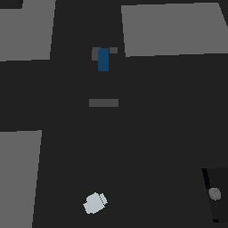

# Multiview Cameras 004: live multiplayer observation and moving-grid camera tracking

## Research question

Can Voidwright observe a human participant and a human-driven moving vehicle
in a shared Space Engineers world, maintain a grid-relative virtual camera,
and produce HoloView captures with identifiable fixture, grid, and perspective
provenance?

The experiment evaluates bounded, read-only perception integration. It does
not evaluate autonomous vehicle control.

## Experimental setup

The experiment used an approved disposable V2R3 fixture and a fresh server
session. The observed vehicle was the `[Voidwright] Blue Utility Truck`.

Before the participant joined, a fresh snapshot reported zero connected
humans. A grid-relative perspective was established at local offset
`(right=0, up=12, forward=-6)` m relative to the truck. One bounded capture
returned a nonblank 256×256 HoloView software render with 203 geometry
primitives, 64,256 visible pixels, and 44 visible colors.

## Procedure

A single human joined the disposable fixture. Voidwright sampled the
participant's anonymous character position, then sampled it again after a
brief walk. The participant subsequently drove the Blue Utility Truck and
parked it. During the human-driven movement, Voidwright sampled the truck
transform, refreshed the same grid-relative perspective, requested bounded
HoloView captures, and inspected one grid cell. Codex issued no vehicle
actuation.

After the session, a fresh observation confirmed zero connected humans. Only
then was the fixture stopped.

## Results

### Human observation

The same anonymous character was observed before and after the brief walk,
with a 4.107 m sample-to-sample displacement.

This establishes a change in observed position, not the exact route, elapsed
movement duration, or speed between samples. Associating the anonymous entity
with the participant relies on the controlled condition that exactly one
human was connected; the export contains no account identity.

### Human-driven vehicle movement

The truck moved 26.291 m between the pre-drive and first moving sample, then
61.878 m from the pre-drive baseline to a later parked sample. Its forward
axis differed by about 171 degrees. Position changed by less than 0.001 m
between the final two samples, consistent with the truck being parked in that
interval.

These are differences between sampled transforms. They do not establish a
continuous trajectory or total distance driven.

### Grid-relative view and structural cross-check

The same grid-relative perspective was used before and after vehicle
movement. Its reported world-space position changed with the truck,
consistent with the virtual perspective updating with the grid's new
transform.

The post-drive 256×256 image had 237 geometry primitives, 64,373 visible
pixels, and 72 unique visible colors. The later parked-truck capture had 250
geometry primitives and 65,384 visible pixels. It is included as

This is a saved-grid software render, not a native framebuffer image. The
capture was tied to the expected fixture, exporter session, target grid, and
perspective.

An exact-cell query returned an occupied `Neon Tubes Corner` block with
complete block coverage. This checks exported grid structure; it is not a
detailed physics-engine raycast.

### Cleanup and regression checks

After the participant disconnected, a fresh observation reported zero
connected humans. The fixture then stopped cleanly, with a successful terminal
state, zero restarts, and zero fixture edits.

After shutdown, `Voidwright.AgentMcpTests` passed 19 checks, including
synthetic player ambiguity/staleness and grid-relative motion/capture guards.
These checks supplement the live trial; they do not add live observations.

## Interpretation and limits

The bounded objectives were met: the fixture reported a connected human and
changing anonymous character pose, a human-driven truck changed position and
orientation, the grid-relative virtual camera updated with the moving grid,
and HoloView returned nonblank software-rendered images tied to the expected
fixture and perspective.

The captures do not demonstrate player-avatar rendering, terrain rendering,
or arbitrary dynamic-scene perception. Structural simulation ticks and
renderer counters are different clocks; their values do not establish
simultaneous observations. The truck was human-driven, not controlled by
Codex. One single-human session does not establish operation with multiple
participants, continuous video, or general navigation reliability.

## Evidence and reproduction

The underlying timestamped observation ledger, filtered measurements, and
terminal receipt are retained with the experiment records. The public image is
the only media asset included; raw server logs and machine-local paths are not
part of this note. No production world was changed.
